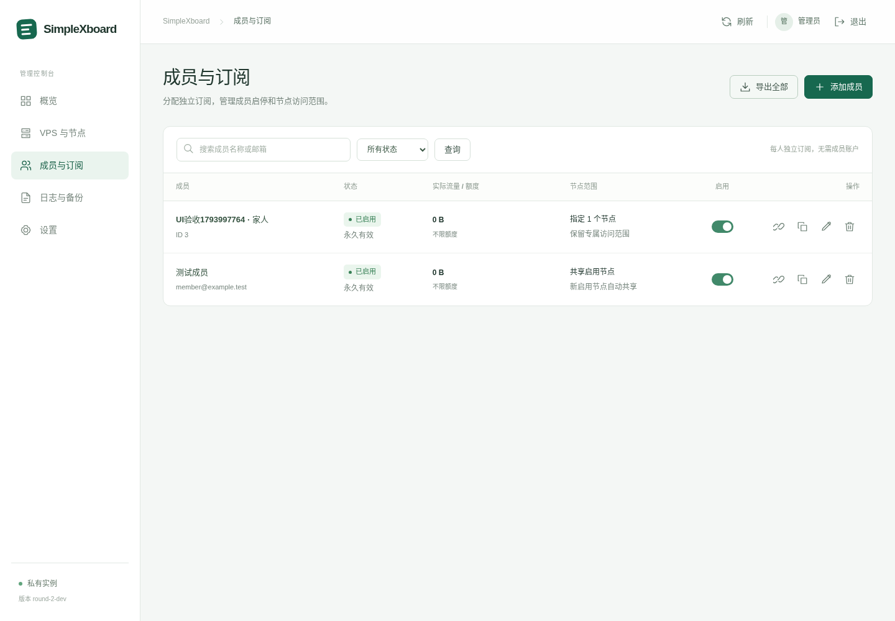
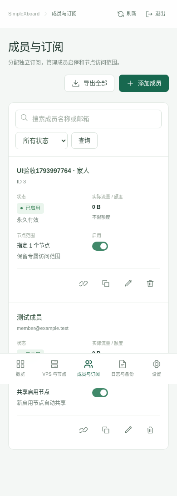

# SimpleXboard 第二轮交接与自测

## 交付范围

本轮从第一轮已合并的 `184394cba29894f4f868128a738cfd456d73fd9f` 继续，目标分支为 `master`，开发分支为 `refactor/round-2-private-panel`。按 `SimpleXboard-Round-2.md` 实现单管理员、成员独立订阅、默认共享启用节点及五菜单管理台。最终提交与合并记录以 GitHub PR 和 `git rev-parse HEAD` 为准。

代码、数据库迁移及测试已在隔离环境实施。没有连接生产数据库、发布镜像、部署 VPS 或修改 Cloudflare。第三轮的协议裁剪、历史导入兼容移除以及 Redis/队列/WebSocket 架构重写不在本轮。

## 主要行为

### 成员、节点与同步

- 删除活动数据模型中的 Plan/group、员工身份与商业字段，安装时不再创建内部套餐。
- 新成员至少有名称或邮箱，默认 `transfer_enable=null`、`expired_at=null`、`access_mode=all`。每人独立 token/UUID，普通成员不保留密码和面板会话。
- 额度 `null` 为不限、`0` 为不可用、正数为硬上限；到期时间 `null` 为永久。取消套餐周期重置，保留明确的手动用量重置。
- 订阅、节点全量列表、增量任务统一使用成员资格和节点授权规则。旧 group 授权转换为直接关联；禁用、删除及旧凭据撤销不再依赖 group 寻找目标节点。
- `enabled=false` 停用节点，`show=false` 只隐藏订阅条目。隐藏节点仍可同步已授权成员。
- 真实联调发现并修复 Workerman 长驻进程缓存旧 `server_token`：每次新握手刷新设置实例。令牌轮换后新令牌可用、旧令牌拒绝。
- 保留原有机器鉴权中的 `is_active` 门槛。机器停用后已建立的 WebSocket 不会每条消息重新鉴权，这是旧架构的限制；节点停用和成员撤权由本轮的同步规则处理。

### 统计口径与迁移

节点上报和新成员统计使用实际字节，移除倍率与分时倍率。旧成员已经累计的额度用量原值保留，不伪称其为实际流量；`legacy_u/legacy_d` 记录迁移边界，新实际量由当前累计减去该边界获得。历史会员倍率统计、商业记录等在迁移归档表中保留，新的 `v2_stat_user` 不含倍率维度。

所有旧成员按原 group 匹配生成直接授权；不能确认历史权限的成员不会自动升级为共享全部节点。历史额度 `null` 转为 `0`，旧 `0` 和正数不变。原有身份凭据、禁用、到期和可保留的用量保持。详细的列、表归档及回退说明见 [迁移文档](round-2-migration.md)。

### 管理台与认证

维护源码位于 `panel/src/`；原管理端产物子模块与用户主题已移除。构建脚本从源码计算内容摘要，输出版本目录和 manifest；相同源码产生相同产物。没有修改旧压缩 JS。

五个一级菜单为「概览」「VPS 与节点」「成员与订阅」「日志与备份」「设置」。成员操作包括创建、编辑、订阅链接、凭据轮换、启停、删除、CSV 导出与手动用量重置。管理台保留机器和目标协议参数、运行诊断、审计、失败队列与备份功能。

登录只接受未禁用管理员，使用有有效期的 Sanctum 会话。改密、撤销全部会话及 CLI 密码恢复会撤销已有令牌。密码字段不裁剪空格。审计递归遮蔽密码、token、secret 和私钥字段。安全路径、订阅路径在请求时校验，保存后无需重建路由即可生效。

备份为本地文件，SQLite 使用一致性的原生快照，MySQL 保留原生 dump 路径。下载需要管理员会话，禁止路径穿越和符号链接。恢复只允许维护模式下的 CLI 显式操作，先保留当前库安全副本；恢复后保持数据库文件原有 owner/group/mode，避免 root CLI 恢复后 Web 进程失去访问权。

### 已退役入口

套餐、分组、员工、普通成员登录/密码找回/邮件登录/快捷登录、用户门户、CMS、主题管理、通用插件与 Hook、Telegram、邮件模板与发送队列、商业筛选/批量账户生成、流量倍率、订阅说明伪节点及第一轮财务零值兼容字段均已清除。必要客户端格式、模板、订阅域名、代理请求处理、节点路由和基础设施保留。

### 构建与更新来源

Dockerfile 从当前本地检出复制后端，Node 阶段从 `panel/` 构建前端，Composer 使用已提交锁文件。Compose 示例使用 `ghcr.io/coderdoubleflower/simplexboard:local` 与本地 build context。在线上游更新服务退役，`xboard:update` 只执行本地版本迁移和缓存清理；容器启动不执行迁移或拉取源码。

Push/PR CI 验证后端、确定性前端、真实同步、浏览器交互与镜像构建，不发布镜像。镜像发布工作流仅支持人工 `workflow_dispatch` 指定标签。

## 自测环境与命令

本地执行环境为 Linux amd64、PHP 8.4.24、PHPUnit 11.5.27、Composer 2.11.1、Redis 8.0.2、SQLite 3.46.1、Python Playwright 1.62.0 、websockets 16.0、Node.js 24.22.1 与 Chrome Headless Shell 151.0.7922.34。PHP 扩展包含 pdo_sqlite、redis/igbinary、pcntl、sockets、sodium、intl、mbstring、zip。Dockerfile 目标 PHP 8.2，容器中版本与扩展由构建步骤实际检查。

```bash
composer validate --no-check-publish
composer install --prefer-dist --no-interaction --no-scripts
php vendor/bin/phpunit
npm --prefix panel ci
npm --prefix panel test
npm --prefix panel run build
python tests/Integration/install.py --artifacts storage/framework/testing/install-e2e
python tests/Support/run-stack.py --artifacts storage/framework/testing/node-e2e -- python tests/Integration/node_lifecycle.py
python tests/Support/run-stack.py --without-scheduler --artifacts storage/framework/testing/panel-e2e -- python panel/tests/e2e.py
git diff --check
```

`run-stack.py` 每次创建临时 SQLite、随机端口 Redis、独立日志和随机管理员密码；真实启动 HTTP、Horizon、Workerman，节点测试同时运行原调度器。所有子进程在同一网络环境中运行，退出后清理。不会读取生产业务数据。

## 验证状态

以下记录实际执行结果；GitHub CI 的最终状态在合并前核对。

| 项目 | 当前证据 |
| --- | --- |
| 后端全量 | 全量 67 tests / 713 assertions 通过；221 个 PHP 文件语法检查无错误 |
| 管理认证与备份 | 12 tests / 62 assertions 通过；包括真实 SQLite 快照、完整性、离线恢复、文件权限、空格密码与异常配置输入 |
| 真实全新安装 | `xboard:install` 临时完整副本 + TCP Redis + HTTP，6/6 场景通过；包含输出密码登录、首个无密码成员、重跑安装不覆写现有记录。见 `docs/verification/round-2-install.json` |
| 核心成员与迁移 | 26 tests / 326 assertions 通过；全新迁移、第一轮升级、可选清理后的升级、身份保持、权限差异、零/不限/正数额度、回退与文件副本验证 |
| 真实节点同步 | 17/17 场景通过；HTTP + Redis + Horizon + Workerman，非消息 mock。报告见 `docs/verification/round-2-node-lifecycle.json` |
| 前端模块与构建 | 15/15 模块测试通过，两次构建 manifest 一致；最终产物版本 `0e935d971535a48d` |
| 浏览器桌面/移动端 | 真实 Chrome Headless Shell：13/13 操作场景通过，12 张截图；1440px 桌面、390px 手机五页及手机操作实际点击通过，无 JavaScript 异常、缺失资源或意外 HTTP 错误。见 `docs/verification/round-2-panel.json` |
| 实际协议连接 | 已固定官方 sing-box 1.14.4 并完成脚本；本地被 netlink 权限阻塞，正在 GitHub CI 的独立 job 执行实际回环连接。见 [协议验证](round-2-protocol-verification.md) |
| 完整镜像构建 | Buildah 已实际拉取基础镜像，但外层仅单 UID/GID 映射，无法解包 `/etc/shadow` 的 group 42。尚未构建成功；见 [构建记录](round-2-build-verification.md) |

真实节点测试覆盖创建、更新、轮换、停用、重连、恢复、直接授权改变、共享权限恢复、硬上限、流量上报耗尽、手动清零、不限额、节点启停、订阅隐藏、删除和节点服务令牌轮换。该次普通增量约 0.1–3.1 秒，额度撤销约 3 秒；这些是本地单次观测，**不是生产 SLA**。队列积压、调度周期与节点实现会影响实际生效时间。

## 外部环境复测

即使本地集成测试通过，以下事项仍需要实际部署环境：

1. 正常 Docker/BuildKit 主机完整构建并运行镜像，核验容器内 PHP、Octane、Caddy、Horizon、调度器和 WebSocket。
2. 使用生产同类型数据库的隔离副本复做备份、迁移和回退。当前真实数据库演练为 SQLite；MySQL/PostgreSQL 尚无运行实例，不能宣称跨数据库验证通过。
3. 使用实际 VPS 节点后端和客户端分别导入 VLESS + REALITY、Hysteria2，验证新连接、已有连接、节点/面板重启、停用/删除/轮换后的撤权行为。控制面消息成功不能代替代理进程的既有连接验证。
4. 核验实际 Cloudflare 订阅域名、TLS/源站保护和反向代理路径。没有该环境时不更改其配置。

复测时记录客户端和节点后端版本、操作时间、队列与节点日志、旧新凭据的连接结果。先使用隔离成员和节点，不以未知生产库做试验。

## 管理台验收截图

以下是隔离测试数据。桌面和手机均使用真实后台 API；完整场景和请求清单见上述 JSON 报告。




